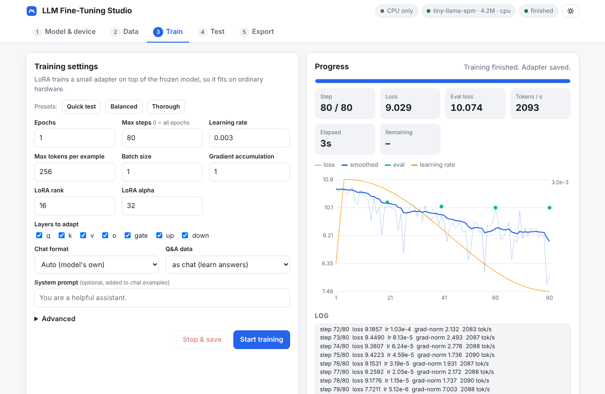
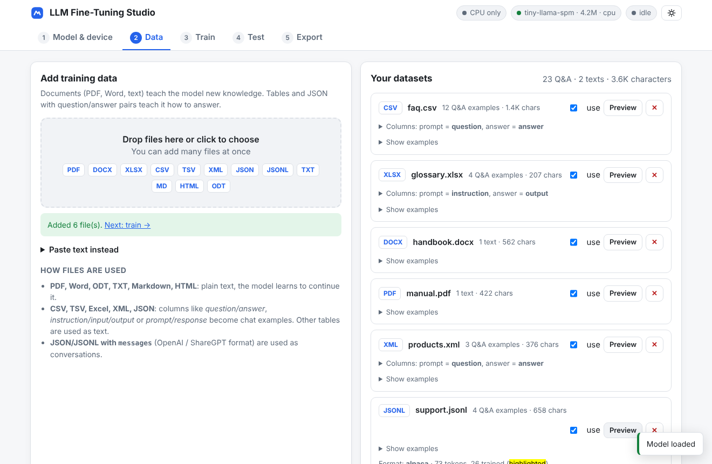

# LLM Fine-Tuning in Rust

Fine-tune open large language models on **your own documents and Q&A data** from a simple web page.
Written from scratch in Rust: tokenizer, transformer, LoRA training loop, data readers, GGUF writer and web UI.

- **Models:** load **GGUF** files (the llama.cpp / Ollama / LM Studio format) or **Hugging Face** folders (`config.json` + `*.safetensors`).
- **Data:** drop in **PDF, Word (.docx), Excel (.xlsx), CSV/TSV, XML, JSON/JSONL**, OpenDocument (.odt), HTML, Markdown or plain text.
- **Hardware:** choose **CPU** or **GPU** (NVIDIA CUDA or Apple Metal) with one click.
- **Training:** LoRA, and QLoRA when the GGUF model is quantized (the base weights stay 4/8-bit in memory).
- **Results:** a LoRA adapter (llama.cpp GGUF and Hugging Face PEFT formats) and/or a **merged model** as GGUF (f16, q8_0, q4_k, …) or safetensors.
- **Test** your model in a chat playground before and after training.



---

## Quick start

1. Install Rust: <https://rustup.rs>
2. Build:

   ```bash
   cargo build --release                      # CPU (Windows, Linux, macOS)
   cargo build --release --features cuda      # + NVIDIA GPU (needs the CUDA toolkit / nvcc)
   cargo build --release --features metal     # + Apple Silicon GPU
   ```

3. Put a model in `workspace/models/` (or upload it from the web page). Good first choices, all on Hugging Face:

   | Model | File | Size |
   |---|---|---|
   | Qwen2.5 0.5B Instruct | `Qwen/Qwen2.5-0.5B-Instruct-GGUF` → `qwen2.5-0.5b-instruct-q8_0.gguf` | 0.5 GB |
   | SmolLM2 360M Instruct | `HuggingFaceTB/SmolLM2-360M-Instruct` (safetensors folder) | 0.7 GB |
   | Llama 3.2 1B Instruct | `bartowski/Llama-3.2-1B-Instruct-GGUF` → `…-Q8_0.gguf` | 1.3 GB |
   | Qwen3 1.7B | `Qwen/Qwen3-1.7B-GGUF` → `Qwen3-1.7B-Q8_0.gguf` | 1.8 GB |

   Models you already downloaded with **Ollama** work too: they are GGUF files in `~/.ollama/models/blobs/` (the largest `sha256-…` file of a model).

4. Start the app and open <http://127.0.0.1:7860>:

   ```bash
   ./target/release/llm-finetune
   ```

## Using the web UI

| Step | What you do |
|---|---|
| **1 · Model & device** | Pick a model, choose **Auto / CPU / NVIDIA GPU / Apple GPU**, choose how base weights are kept in memory, press **Load model**. |
| **2 · Data** | Drag & drop files. Each file shows what was found (texts or Q&A pairs). For tables you can choose which columns are the *prompt* and the *answer*. **Preview** shows exactly what the model will see, with the trained part highlighted. |
| **3 · Train** | Pick a preset (*Quick test*, *Balanced*, *Thorough*) or set epochs, learning rate, LoRA rank, etc. Press **Start training** and watch the loss curve, speed and remaining time. **Stop & save** keeps the work done so far. |
| **4 · Test** | Chat with the model. The adapter is active right after training, so you can compare answers before and after. |
| **5 · Export** | Download the adapter, or export a **merged** model as GGUF (choose a quantization) or safetensors. |



Everything is stored under `workspace/` (`models/`, `outputs/run-…/`).
Run `llm-finetune serve --help` for host, port and folder options. The server listens on `127.0.0.1` only, unless you pass `--host 0.0.0.0`.

## How your files are used

| File | Becomes |
|---|---|
| PDF, Word `.docx`, `.odt`, `.txt`, `.md`, `.html` | **Plain text.** The model learns the content (continued pre-training). Text is cleaned, joined and cut into pieces of *max tokens per example*. |
| CSV / TSV / Excel / XML / JSON with columns like `question`+`answer`, `instruction`+`input`+`output`, `prompt`+`response` | **Q&A examples.** They are wrapped in the model's chat format, and only the answers are trained (the prompt is context). You can change the column mapping in the UI. |
| JSON / JSONL with `messages` (OpenAI) or `conversations` (ShareGPT) | **Multi-turn conversations** (system prompts included). |
| Any other table | Plain text, one example per row (`column: value` lines). |

Old binary `.doc` files and scanned PDFs (images without text) are not supported: save as `.docx` / run OCR first.
Example files for every format are in [`examples/data`](examples/data).

## Command line

The same engine is available without the browser:

```bash
# fine-tune
llm-finetune train --model qwen2.5-0.5b-instruct-q8_0.gguf \
    --data examples/data/faq.csv examples/data/manual.pdf \
    --epochs 3 --lr 2e-4 --rank 16 --device auto --output out/my-run \
    --merge-gguf q8_0            # optional: also write out/my-run/merged.gguf

# chat with the result
llm-finetune generate --model qwen2.5-0.5b-instruct-q8_0.gguf --adapter out/my-run \
    --prompt "What are your opening hours?"

# merge an adapter later
llm-finetune merge --model base.gguf --adapter out/my-run --output merged-q4.gguf --quant q4_k

llm-finetune info --model base.gguf          # architecture, tokenizer, chat format
```

`llm-finetune train --help` lists every option. `--config file.json` accepts the same settings as the UI (see `GET /api/train/defaults`).

## Supported models

| Family | GGUF `general.architecture` | Hugging Face `model_type` |
|---|---|---|
| Llama 2, Llama 3 / 3.1 / 3.2, TinyLlama, SmolLM 1/2, Mistral 7B and other Llama-architecture fine-tunes | `llama` | `llama`, `mistral` |
| Qwen 2, Qwen 2.5 (incl. Coder / Math) | `qwen2` | `qwen2` |
| Qwen 3 (dense) | `qwen3` | `qwen3` |

GGUF weight types: F32, F16, BF16, Q4_0, Q4_1, Q5_0, Q5_1, Q8_0, Q2_K–Q6_K (the I-quants `IQ*` are not supported).
Tokenizers: SentencePiece (Llama 2 style) and byte-level BPE with all common pre-tokenizers (Llama 3, Qwen 2/3.5, GPT-2, SmolLM/StarCoder, Phi-3, DeepSeek, Falcon, …).
Chat formats are read from the model (its Jinja template). Built-ins: ChatML, Llama 3, Llama 2, Mistral, Zephyr, Phi-3, Alpaca, plain.

## Hardware and memory

| Setting | What it means |
|---|---|
| **Device** | *Auto* uses a GPU when one is built in and present, else the CPU. GPU builds need `--features cuda` or `--features metal`. |
| **Base weights in memory** | *Keep as in file*: a Q4/Q8 GGUF stays quantized (QLoRA, least memory). *f32*: fastest on CPU, 4 bytes per parameter. *f16/bf16*: half that. *q8_0 / q4_k*: quantize a safetensors model when it is loaded. |
| **Gradient checkpointing** (Advanced, on by default) | Recomputes one layer at a time during the backward pass, which uses much less memory and is a little slower. |

Measured on a 4-core cloud VM (Xeon, AVX-512) with a Qwen2.5-0.5B-sized model, 256 tokens per step:

| Base weights | Speed | Peak RAM (with checkpointing) |
|---|---|---|
| f32 | 25–32 tokens/s | 2.3 GB |
| q8_0 / q4_0 (QLoRA) | ~20 tokens/s | 1.9 GB |

A desktop with more cores is proportionally faster, and a GPU much faster. Rough guide: 1,000 Q&A pairs of ~100 tokens is ~100k tokens per epoch, about an hour per epoch for a 0.5B model on 4 CPU cores.
The build uses `-C target-cpu=native` (see `.cargo/config.toml`), so the binary is tuned for the computer that compiled it. Add `--features mkl` (Intel) or `--features accelerate` (macOS) for faster CPU math.

## Using the results

Each training run writes to `workspace/outputs/run-<date>/`:

| File | Use it with |
|---|---|
| `adapter.gguf` | llama.cpp: `llama-cli -m base.gguf --lora adapter.gguf` · llama-server (`--lora`) · Ollama (`ADAPTER ./adapter.gguf` in a Modelfile, with `FROM` the same base GGUF) |
| `adapter_model.safetensors` + `adapter_config.json` | Hugging Face PEFT: `PeftModel.from_pretrained(base_model, "run-dir")` |
| `training_log.json` | Settings and the loss of every step |
| merged `.gguf` (Export tab or `--merge-gguf`) | One self-contained model: Ollama `FROM ./merged.gguf`, LM Studio, llama.cpp, Jan, GPT4All, … |

Adapters always match the base model they were trained on. Merged GGUF files keep the base model's tokenizer and chat template.

## How it works

```
src/
├── tokenizer.rs     SentencePiece + byte-level BPE, read from GGUF metadata or tokenizer.json
├── model/
│   ├── mod.rs       Llama/Qwen transformer: RMSNorm, RoPE (both layouts), GQA attention, SwiGLU, KV cache
│   ├── load.rs      GGUF and safetensors loaders, optional quantize-on-load
│   ├── linear.rs    frozen (dense or quantized) weights + LoRA adapters
│   └── ops.rs       fused ops with hand-written backward passes, fused cross-entropy
├── data/            PDF / Word / Excel / CSV / XML / JSON / HTML readers, column mapping, sample building
├── chat.rs          chat templates (Jinja via minijinja + built-ins) and answer-only loss masks
├── train.rs         training loop: AdamW, warm-up + cosine/linear schedule, clipping, accumulation,
│                    gradient checkpointing, evaluation, checkpoints
├── export.rs        PEFT + GGUF adapters, merged GGUF / safetensors
├── gguf_writer.rs   streaming GGUF v3 writer
├── generate.rs      sampling (temperature, top-k, top-p, repetition penalty)
├── server.rs        JSON API + embedded single-page UI (src/ui/index.html)
└── main.rs          command line
```

Tensors, autograd and the CPU/CUDA/Metal kernels come from [candle](https://github.com/huggingface/candle). The rest is implemented here. Some details:

- **Frozen weights never get gradients.** Each projection runs outside autograd and is re-attached with a custom op whose backward pass only computes `dL/dx = dL/dy · W`. For quantized weights `W` is dequantized on the fly, so a 4-bit model stays 4-bit in memory (QLoRA).
- **Fused ops.** RMSNorm, RoPE and softmax use candle's fused kernels forward and closed-form gradients backward.
- **The vocabulary projection** (the largest matrix, e.g. 152k × 896) runs in chunks with a fused, multi-threaded cross-entropy, so the full logits matrix never exists.
- **Llama GGUF files store Q/K rows permuted.** The model uses the matching RoPE layout. Adapters are converted between the llama.cpp and Hugging Face layouts on export and import.

## Verification

```bash
cargo test --release
```

- Unit tests for every data reader, the tokenizers, sampling, the fused ops (against autograd) and the GGUF permutations.
- `tests/gradients.rs`: LoRA gradients vs **finite differences** (three model variants), gradient checkpointing vs the full graph (with dropout), and QLoRA vs dense gradients.
- `tests/training.rs`: CSV + text → training (the loss must drop) → saved PEFT and GGUF adapters → reload gives identical outputs.
- `tests/llama_cpp_vocab.rs`: set `LLAMA_VOCAB_DIR=<llama.cpp>/models` to compare against llama.cpp's reference tokenizations.
  All 14 supported vocabularies match exactly (Llama 2 SPM, Llama 3, Qwen2, Qwen3.5, GPT-2, Phi-3, StarCoder, Refact, Falcon, MPT, Command-R, DeepSeek Coder/LLM, …).

These were also checked against llama.cpp itself while developing (`examples/dump_logits.rs`):

- Logits agree with an independent float64 reference to ~2·10⁻⁶ for Llama, Qwen2 and Qwen3, from both GGUF and safetensors.
- Adapters trained here give the same logits in llama.cpp (`--lora`) to ~10⁻⁶.
- Merged GGUF files load in llama.cpp and tokenize identically.

`examples/bench_train.rs` measures training speed for real-world model shapes.

## Limitations

- Dense decoder models of the Llama / Qwen families only (no Gemma, Phi, Mixture-of-Experts or vision models yet).
- One device per run (no multi-GPU).
- The CUDA and Metal backends come from candle and are enabled with cargo features. The test suite above ran on CPU.
- YaRN / dynamic RoPE scaling is ignored, which is fine for training sequences inside the original context length.

## License

MIT, see [LICENSE](LICENSE).
